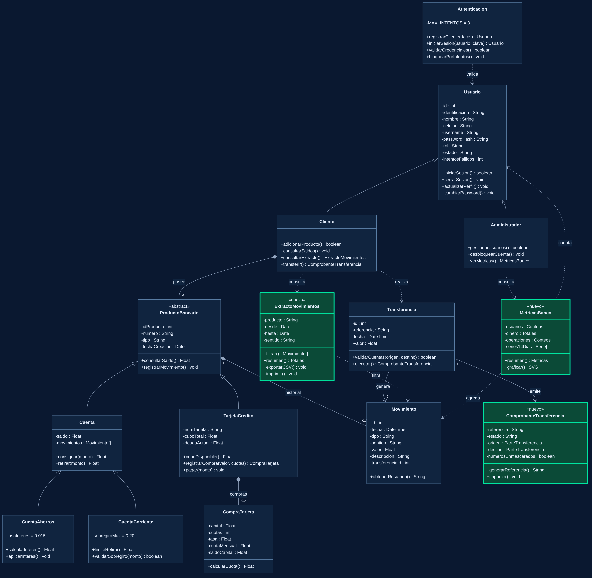

# 🏦 Mi Plata – Banco digital

Aplicación web bancaria desarrollada como proyecto final de la asignatura **Front-end**. El cliente está hecho en **JavaScript puro** (HTML + CSS + JS, **sin frameworks**), se comunica por `fetch` con una **API REST en PHP** y guarda toda la información en una base de datos **MySQL** (XAMPP).


## Contenido
1. [Funcionalidades](#1-funcionalidades)
2. [Tecnologías](#2-tecnologías)
3. [Arquitectura](#3-arquitectura)
4. [Estructura del proyecto](#4-estructura-del-proyecto)
5. [Base de datos](#5-base-de-datos)
6. [API en PHP](#6-api-en-php)
7. [DOM Traversing](#7-dom-traversing)
8. [Otros conceptos de front-end aplicados](#8-otros-conceptos-de-front-end-aplicados)
9. [Reglas de negocio](#9-reglas-de-negocio)
10. [Seguridad](#10-seguridad)
11. [Instalación en XAMPP](#11-instalación-en-xampp)
12. [Pruebas](#12-pruebas)
13. [Historias de usuario](#13-historias-de-usuario)

---

## 1. Funcionalidades

| Módulo | Qué permite |
|---|---|
| **Acceso** | Registro, inicio de sesión, bloqueo tras 3 intentos fallidos (contador visible) y cierre de sesión. |
| **Cuentas** | Cuenta de ahorros (interés 1.5 %) y cuenta corriente (sobregiro 20 %): consultar saldo, consignar y retirar. |
| **Transferencias** | Entre productos propios o a otro usuario, con **comprobante imprimible** *(nuevo)*. |
| **Extracto** | Movimientos con filtros por producto, tipo y **rango de fechas**, totales, descarga **CSV** e impresión/PDF *(nuevo)*. |
| **Tarjeta de crédito** | Compras a cuotas con tasa según plazo, simulador y pago desde las cuentas. |
| **Perfil** | Edición de datos y cambio de contraseña. |
| **Administrador** | CRUD de usuarios y **panel de métricas** con gráficas *(nuevo)*. |
| **Experiencia** | Diseño futurista, tema claro/oscuro, tamaño de texto ajustable, gráfica de entradas y salidas, landing page con mega-menú y carrusel. |

**Credenciales de prueba:** administrador `admin` / `Admin123`. Los clientes se crean desde *Registrarse*.

## 2. Tecnologías

| Capa | Tecnología |
|---|---|
| Presentación | HTML5, CSS3 (variables CSS, tema claro/oscuro), JavaScript ES2022 (clases, módulos por archivo, `async/await`) |
| Comunicación | `fetch` + JSON, cookie de sesión |
| Servidor | PHP 7.4+ (PDO, sesiones, `password_hash`) |
| Datos | MySQL / MariaDB (InnoDB, transacciones) |
| Entorno | XAMPP (Apache + MySQL) |
| Pruebas | Node.js 18+ (pruebas de la API) |

## 3. Arquitectura

Arquitectura **cliente–servidor en capas**. El navegador solo pinta y valida el formato; **el servidor es la fuente de verdad**: aplica las reglas del banco y es el único que escribe en la base de datos.

```
┌────────────────────────── NAVEGADOR ──────────────────────────┐
│  Vista (HTML + CSS)                                           │
│     ↕ eventos / DOM                                           │
│  Controladores de vista: app.js · dashboardApp.js ·           │
│                          adminApp.js · adminMetricas.js       │
│     ↓ await                                                   │
│  Controladores de negocio JS: AuthController · BankController │
│     ↓                      ↘ Modelos (Usuario, Cuenta,        │
│  ApiClient.js (fetch)         CuentaAhorros, CuentaCorriente, │
│                               TarjetaCredito, Transaccion)    │
└───────────────┬───────────────────────────────────────────────┘
                │  HTTP + JSON  (cookie MIPLATASESSID)
┌───────────────▼────────────────── SERVIDOR (PHP) ─────────────┐
│  api/index.php  → enrutador (front controller)                │
│     ↓                                                         │
│  Controladores: AuthController · UsuarioController ·          │
│                 BankController · MetricasController           │
│     ↓                                                         │
│  Reglas.php (intereses, sobregiro, cuotas)                    │
│  Repositorio.php (consultas SQL) · Database.php (PDO)         │
└───────────────┬───────────────────────────────────────────────┘
                │  SQL (consultas preparadas, transacciones)
          ┌─────▼─────┐
          │   MySQL   │  usuarios · productos · movimientos ·
          └───────────┘  transferencias · compras_tarjeta
```

### Responsabilidad de cada capa
| Capa | Responsabilidad | Archivos |
|---|---|---|
| **Vista** | Estructura y estilo de las pantallas | `index.html`, `view/*.html`, `css/styles.css` |
| **Controlador de vista** | Escucha eventos, lee formularios y repinta el DOM | `js/app.js`, `dashboardApp.js`, `adminApp.js`, `adminMetricas.js`, `ui.js` |
| **Controlador de negocio (JS)** | Orquesta cada caso de uso y llama a la API | `controllers/AuthController.js`, `BankController.js` |
| **Modelo (JS)** | Representa los datos recibidos y calcula vistas previas | `js/models/*.js` |
| **Acceso a la API** | `fetch`, manejo de errores y de sesión vencida | `js/data/ApiClient.js` |
| **API (PHP)** | Reglas de negocio, permisos y persistencia | `api/**` |

### Flujo de una operación (ejemplo: transferir)
1. El cliente envía el formulario → `dashboardApp.js` lo intercepta con `submit`.
2. `BankController.transferir()` valida el monto y llama a `ApiClient.post('transferir', …)`.
3. `api/index.php` enruta a `BankController::transferir()` (PHP), que verifica la sesión.
4. Dentro de **una transacción SQL** se bloquean las dos cuentas (`SELECT … FOR UPDATE`), se valida el límite, se crea el comprobante y se registran los dos movimientos.
5. La API responde `{ ok, saldoOrigen, comprobante }`; la vista recarga los datos y muestra el comprobante en un `<dialog>`.

## 4. Estructura del proyecto

```
miplata/
├── index.html                      Landing: mega-menú, carrusel, simulador, preguntas frecuentes
├── css/styles.css                  Sistema de diseño (tema claro/oscuro con variables CSS)
├── img/                            Fotografías de la página de inicio
├── view/                           auth.html · dashboard.html · admin-users.html
├── js/
│   ├── app.js · ui.js              Utilidades, login/registro, tema, carrusel, FAQ (traversing)
│   ├── dashboardApp.js             Panel del cliente: saldo, extracto, transferencias, tarjeta
│   ├── adminApp.js                 CRUD de usuarios
│   ├── adminMetricas.js            Pestaña de métricas del administrador
│   ├── charts.js                   Gráficas SVG hechas a mano (barras, dona, horizontales)
│   ├── documentos.js               CSV, extracto y comprobante imprimibles
│   ├── data/ApiClient.js           fetch + manejo de errores
│   └── models/                     Cuenta, CuentaAhorros, CuentaCorriente, TarjetaCredito, Usuario, Transaccion
├── controllers/                    AuthController.js · BankController.js (clientes de la API)
├── api/                            Backend PHP
│   ├── index.php                   Enrutador (?accion=login, ?accion=transferir, …)
│   ├── config.php                  Conexión a MySQL y zona horaria
│   ├── Database.php                PDO + transacciones
│   ├── Reglas.php                  Reglas de negocio del banco
│   ├── Repositorio.php             Consultas SQL
│   ├── Util.php                    Errores, JSON, sesión y validaciones
│   └── controllers/                AuthController · UsuarioController · BankController · MetricasController
├── database/
│   ├── miplata.sql                 Instalación nueva (esquema + administrador)
│   └── actualizar_v3_a_v4.sql      Migración para quien ya tenía la versión anterior
├── tests/api-test.js               90 verificaciones automáticas de la API
└── docs/                           Diagrama UML e historias de usuario
```

## 5. Base de datos

```
usuarios ─┬─< productos ─┬─< movimientos >─ transferencias
          │              └─< compras_tarjeta
          └──────────────────────────────< transferencias (origen y destino)
```

| Tabla | Contenido |
|---|---|
| `usuarios` | Identificación, nombre, celular, usuario (únicos), `password_hash`, rol (`cliente`/`admin`), estado e intentos fallidos. |
| `productos` | Cada usuario tiene uno de cada tipo (`ahorros`, `corriente`, `tarjeta`) con número, saldo, cupo y deuda. |
| `movimientos` | Fecha (UTC), tipo, sentido (entrada/salida), valor, descripción y, si aplica, el comprobante asociado. |
| `transferencias` | Comprobante: referencia única `MP-XXXXXXXX`, fecha, valor y la "foto" de quién envió a quién. |
| `compras_tarjeta` | Capital, cuotas, tasa, cuota mensual y saldo pendiente. |

- Las llaves foráneas de `productos`, `movimientos` y `compras_tarjeta` usan `ON DELETE CASCADE`; en `transferencias` se usa `SET NULL` para **conservar el comprobante** aunque se elimine un usuario.
- Las fechas se guardan en UTC y el navegador las muestra en la hora local.

## 6. API en PHP

Un único punto de entrada (`api/index.php?accion=<nombre>`) reparte cada petición al controlador correspondiente (patrón *front controller*). Todas las respuestas son JSON: `{ "ok": true, … }` o `{ "ok": false, "mensaje": "…", "errores": { "campo": "…" } }`.

| Acción | Método | Quién puede usarla |
|---|---|---|
| `registro`, `login`, `intentos` | POST, POST, GET | Público |
| `me`, `logout`, `perfil`, `password` | GET / POST | Usuario con sesión |
| `consignar`, `retirar`, `transferir`, `compra`, `pago_tarjeta` | POST | Cliente con sesión |
| `comprobante?id=N` | GET | Solo quien envió o quien recibió |
| `usuarios`, `usuario_crear`, `usuario_editar`, `usuario_eliminar` | GET / POST | Solo administrador |
| `metricas` | GET | Solo administrador |

Códigos HTTP usados: `200` correcto · `401` sin sesión · `403` sin permiso · `404` no existe · `405` método no permitido · `422` datos inválidos · `423` cuenta bloqueada.

## 7. DOM Traversing

*Traversing* es **recorrer el árbol del DOM** partiendo de un elemento: subir a sus ancestros, bajar a sus hijos o moverse entre hermanos. En lugar de buscar todo con `getElementById`, se parte del elemento donde ocurrió el evento y se navega hasta lo que se necesita.

| Método | Dirección | Ejemplo real del proyecto |
|---|---|---|
| `closest(selector)` | ↑ ancestros | `e.target.closest('[data-seccion]')` encuentra el botón del menú aunque se haga clic en su icono (`dashboardApp.js`). |
| `parentElement` | ↑ padre | `pregunta.parentElement` abre el ítem de la FAQ (`ui.js`). |
| `children` | ↓ hijos | `[...chip.parentElement.children]` marca solo el filtro de fechas pulsado entre sus hermanos (`dashboardApp.js`). |
| `querySelector` (sobre un elemento) | ↓ descendientes | `carrusel.querySelector('.carrusel-pistas')` busca solo dentro del carrusel (`ui.js`). |
| `firstElementChild` / `lastElementChild` | ↓ extremos | El carrusel vuelve al primer o al último slide (`ui.js`). |
| `nextElementSibling` / `previousElementSibling` | → ← hermanos | Botones siguiente/anterior del carrusel (`ui.js`). |

**Patrón principal: delegación de eventos + `closest()`.** En vez de poner un listener a cada botón, se pone **uno solo** en el contenedor y `closest()` descubre qué botón se pulsó. Funciona incluso con filas creadas dinámicamente:

```js
// adminApp.js – un listener para TODAS las filas de la tabla de usuarios
tablaUsuarios.addEventListener('click', (e) => {
  const boton = e.target.closest('button[data-editar], button[data-eliminar]'); // ↑ sube al botón
  if (!boton) return;
  const fila = boton.closest('tr');                                            // ↑ sube a la fila
  Array.from(fila.parentElement.children)                                      // ↓ todas las filas hermanas
       .forEach((f) => f.classList.toggle('fila-activa', f === fila));
});
```

**Ventajas:** menos listeners (mejor rendimiento), funciona con elementos que aparecen después y el código no depende de ids repetidos. La explicación detallada está comentada al inicio de `js/ui.js`.

## 8. Otros conceptos de front-end aplicados

| Concepto | Dónde verlo |
|---|---|
| `fetch`, `async/await`, promesas y manejo de errores | `js/data/ApiClient.js`, `controllers/*.js` |
| Delegación de eventos | `ui.js`, `dashboardApp.js`, `adminApp.js` |
| Clases, herencia y polimorfismo | `CuentaAhorros` y `CuentaCorriente` extienden `Cuenta` |
| Variables CSS y tema claro/oscuro (`data-theme`) | `css/styles.css` |
| `IntersectionObserver` (animaciones al hacer scroll) | `ui.js` |
| SVG generado con JavaScript (gráficas sin librerías) | `dashboardApp.js`, `js/charts.js` |
| Elemento nativo `<dialog>`, `Blob` y descarga de archivos, impresión con iframe | `dashboard.html`, `js/documentos.js` |
| *Debounce* (esperar antes de consultar al servidor) | `app.js` (contador de intentos) |
| Accesibilidad (`aria-*`, foco visible, tamaño de texto) | `view/*.html`, `ui.js` |
| Diseño responsive y `prefers-reduced-motion` | `css/styles.css` |
| Agregaciones SQL (`COUNT`, `SUM`, `GROUP BY`) | `api/controllers/MetricasController.php` |

## 9. Reglas de negocio

Se aplican en el **servidor** (`api/Reglas.php`), por lo que no se pueden evadir modificando el JavaScript del navegador.

- **Ahorros:** no se puede retirar más que el saldo. Al retirar se abona el **1.5 %** mensual como movimiento "interés" y luego se descuenta el retiro.
- **Corriente:** sin intereses. Se puede retirar hasta `saldo × 1.2` (sobregiro del 20 %).
- **Tarjeta:** cupo inicial de $3.000.000. Cuotas ≤ 2 → 0 %; 3 a 6 → 1.9 %; ≥ 7 → 2.3 % mensual. `Cuota = (Capital × tasa) / (1 − (1 + tasa)^−n)`.
- **Transferencias:** entre productos propios o a otro usuario; nunca al mismo producto ni al administrador.
- **Login:** 3 intentos fallidos bloquean la cuenta; solo el administrador la desbloquea.

## 10. Seguridad

- Contraseñas con **hash** (`password_hash` / `password_verify`); nunca viajan de vuelta al navegador.
- **Consultas preparadas** (PDO) contra inyección SQL.
- **Sesión en el servidor** (cookie `HttpOnly`, `SameSite=Lax`); el rol se verifica en cada petición.
- **Transacciones** con bloqueo de filas: dos operaciones simultáneas no dejan saldos incorrectos.
- Salida escapada en el DOM (`escapar()`) contra XSS.
- El rol enviado al registrarse se ignora: siempre es `cliente`.
- Los comprobantes solo los ve quien envió o quien recibió; para terceros la API responde "no existe".

## 11. Instalación en XAMPP

1. Instala **XAMPP** y enciende **Apache** y **MySQL**.
2. Copia esta carpeta en `C:\xampp\htdocs\` y renómbrala **`miplata`**.
3. Abre <http://localhost/phpmyadmin> → **Importar** → `database/miplata.sql` → **Continuar**.
4. Entra a **<http://localhost/miplata/>**.
5. Ingresa como `admin` / `Admin123` o regístrate como cliente.

> Abre siempre el sitio desde `http://localhost/...`; con doble clic en `index.html` el navegador no puede comunicarse con PHP.

**Actualizar desde la versión anterior:** importa **una sola vez** `database/actualizar_v3_a_v4.sql` (conserva los datos y agrega los comprobantes).

| Problema | Solución |
|---|---|
| "No se pudo conectar con el servidor" | Enciende Apache y entra por `http://localhost/miplata/`. |
| "No se pudo usar la base de datos…" | Enciende MySQL e importa `database/miplata.sql`. |
| Error de conexión a MySQL | Si `root` tiene contraseña, escríbela en `api/config.php`. Usa `MIPLATA_DEBUG=1` para ver el detalle. |
| Empezar de cero | Vuelve a importar `database/miplata.sql`. |
| Usar Live Server | Define `window.MIPLATA_API_URL='http://localhost/miplata/api/index.php'` antes de los scripts. |

## 12. Pruebas

Con Apache y MySQL encendidos y Node 18+:

```bash
node tests/api-test.js http://localhost/miplata/api/index.php
```

Ejecuta **90 verificaciones**: validaciones, bloqueo por intentos, permisos por rol, reglas de intereses y sobregiro, transferencias y comprobantes, métricas, eliminación en cascada y **concurrencia** (10 retiros simultáneos sobre la misma cuenta).

## 13. Historias de usuario

Redactadas en tercera persona. Las **nuevas funcionalidades** son **HU-26** (extracto), **HU-27** (comprobante) y **HU-28** (métricas). El mismo contenido está en [`docs/historias-de-usuario.md`](docs/historias-de-usuario.md).

### Roles

| Rol | Descripción |
|---|---|
| Visitante | Persona que aún no ha iniciado sesión. |
| Cliente | Usuario registrado que opera sus productos bancarios. |
| Administrador | Usuario con permisos para gestionar a los demás usuarios del sistema. |

### Índice

| Módulo | Historias |
|---|---|
| Acceso y seguridad | HU-01, HU-02, HU-03 |
| Página de inicio | HU-04 |
| Panel de transacciones | HU-05 a HU-11, HU-16, HU-26, HU-27 |
| Tarjeta de crédito | HU-12, HU-13 |
| Perfil | HU-14, HU-15 |
| Administración de usuarios | HU-17, HU-18, HU-19, HU-28 |
| Experiencia de usuario | HU-20, HU-21, HU-22, HU-23 |
| Datos y seguridad | HU-24, HU-25 |

---

### Acceso y seguridad

#### HU-01: Registro de Nuevos Clientes

* Como visitante de la plataforma web,
* Quiero poder registrarme ingresando mis datos personales (número de identificación, nombre completo, celular, nombre de usuario y contraseña con confirmación),
* Para crear una cuenta en el sistema y poder acceder a los servicios bancarios digitales de "Mi Plata".
* Criterios de aceptación:
   * El formulario valida que todos los campos estén llenos y muestra el error debajo de cada campo inválido.
   * La identificación (cédula o pasaporte) tiene entre 5 y 15 letras o números y no puede repetirse.
   * El nombre completo incluye nombre y apellido, solo con letras.
   * El celular tiene 10 dígitos y comienza por 3.
   * El nombre de usuario es único en el sistema, tiene entre 4 y 20 caracteres (letras, números, punto o guion bajo).
   * La contraseña tiene mínimo 8 caracteres con mayúscula, minúscula y número, y coincide con su confirmación.
   * Se almacena el nuevo usuario en la tabla `usuarios` de MySQL con rol `cliente` y su contraseña protegida con hash.
   * Al registrarse, el sistema le crea automáticamente una cuenta de ahorros, una cuenta corriente y una tarjeta de crédito.
   * Muestra un mensaje de éxito y cambia automáticamente al formulario de inicio de sesión con el usuario ya escrito.

#### HU-02: Inicio de Sesión

* Como cliente o administrador registrado,
* Quiero poder iniciar sesión con mi nombre de usuario y contraseña,
* Para acceder de forma segura a mis productos bancarios o a las herramientas de administración.
* Criterios de aceptación:
   * El formulario exige usuario y contraseña, y valida las credenciales contra los usuarios almacenados.
   * Si el usuario no existe, muestra el mensaje "El usuario no está registrado".
   * Si la contraseña es incorrecta, muestra un mensaje de error y cuántos intentos le quedan.
   * Si las credenciales son correctas, el sistema guarda la sesión y redirige al panel de transacciones (cliente) o a la administración de usuarios (administrador).
   * Un visitante que intenta abrir el panel sin sesión es redirigido a la página de inicio de sesión.

#### HU-03: Bloqueo por Intentos Fallidos

* Como administrador del banco,
* Quiero que el sistema bloquee la cuenta tras tres intentos fallidos de inicio de sesión,
* Para proteger los productos de los clientes frente a accesos no autorizados.
* Criterios de aceptación:
   * El contador de intentos fallidos ("Intentos fallidos: X de 3") es visible durante todo el proceso de inicio de sesión.
   * Al tercer intento fallido, la cuenta cambia a estado `bloqueado` y se muestra un mensaje informativo.
   * Una cuenta bloqueada no puede ingresar, ni siquiera con la contraseña correcta.
   * El contador se reinicia a cero cuando el inicio de sesión es exitoso.
   * Un administrador puede desbloquear la cuenta desde la administración de usuarios (ver HU-18).

---

### Página de inicio

#### HU-04: Página de Inicio (Landing Page)

* Como visitante de la plataforma web,
* Quiero ver una página principal atractiva con la presentación del banco y accesos claros a Iniciar Sesión y Registrarse,
* Para conocer a "Mi Plata", sus productos y decidir si abro una cuenta.
* Criterios de aceptación:
   * El menú de navegación incluye las opciones "Iniciar Sesión" y "Registrarse".
   * Presenta la información institucional del banco (misión, visión) y sus tres productos con sus condiciones.
   * Usa una identidad visual coherente con un banco (colores, logo y tipografía).
   * Incluye un pie de página con información corporativa y enlaces a redes sociales.
   * Las páginas de registro e inicio de sesión mantienen el mismo diseño visual que la página de inicio.
   * La página se adapta a pantallas de celular y de computador.

---

### Panel de transacciones

#### HU-05: Consultar Saldo

* Como cliente autenticado,
* Quiero consultar el saldo de cada uno de mis productos,
* Para conocer cuánto dinero tengo disponible antes de realizar una operación.
* Criterios de aceptación:
   * Muestra el saldo de la cuenta de ahorros y de la cuenta corriente, con su número de cuenta.
   * Para la cuenta corriente muestra además el límite de retiro con sobregiro.
   * Para la tarjeta de crédito muestra el cupo total, el cupo disponible y la deuda actual.
   * Los valores se muestran en formato de moneda colombiana.

#### HU-06: Consignar Dinero

* Como cliente autenticado,
* Quiero consignar dinero en mi cuenta de ahorros o en mi cuenta corriente,
* Para aumentar mi saldo disponible.
* Criterios de aceptación:
   * El cliente selecciona la cuenta destino e ingresa el monto.
   * El monto debe ser un número mayor a cero; de lo contrario, muestra un mensaje de error.
   * El saldo se actualiza y se muestra el nuevo valor.
   * La operación queda registrada como movimiento de tipo `consignación`.

#### HU-07: Retirar Dinero de la Cuenta de Ahorros

* Como cliente autenticado,
* Quiero retirar dinero de mi cuenta de ahorros,
* Para disponer de mi dinero en efectivo cuando lo necesite.
* Criterios de aceptación:
   * El monto a retirar no puede superar el saldo disponible; de lo contrario, muestra un mensaje de error y no modifica el saldo.
   * El sistema calcula el interés del 1.5% mensual sobre el saldo y lo abona en el momento del retiro.
   * Antes de confirmar, muestra una vista previa del interés y del saldo resultante.
   * El saldo se actualiza y se muestra el nuevo valor.
   * Quedan registrados dos movimientos: `interés` y `retiro`.

#### HU-08: Retirar Dinero de la Cuenta Corriente con Sobregiro

* Como cliente autenticado,
* Quiero retirar dinero de mi cuenta corriente aprovechando el sobregiro permitido,
* Para cubrir pagos urgentes aunque mi saldo no alcance.
* Criterios de aceptación:
   * El cliente puede retirar hasta un 20% adicional sobre su saldo actual (ejemplo: con $1.000.000 el límite es $1.200.000).
   * Si el monto supera ese límite, muestra un mensaje de error y no modifica el saldo.
   * Cuando el retiro usa sobregiro, el sistema informa cuánto se está sobregirando.
   * La cuenta corriente no genera intereses.
   * El saldo se actualiza (puede quedar negativo) y el retiro queda registrado como movimiento.

#### HU-09: Ver Movimientos

* Como cliente autenticado,
* Quiero consultar el historial de mis movimientos,
* Para llevar control de mis transacciones.
* Criterios de aceptación:
   * Cada movimiento almacena fecha y hora, tipo de transacción (retiro, consignación, transferencia, etc.) y valor.
   * Los movimientos se guardan en una estructura de tipo `Array`.
   * El historial se muestra de forma legible, ordenado por fecha descendente (del más reciente al más antiguo).
   * Las entradas se distinguen de las salidas por signo y color.
   * El cliente puede filtrar por producto (ahorros, corriente, tarjeta) o ver todos.
   * Si no hay movimientos, muestra un mensaje indicándolo.

#### HU-10: Transferir entre Productos Propios

* Como cliente autenticado,
* Quiero transferir dinero entre mis propios productos (por ejemplo, de Ahorros a Corriente),
* Para organizar mi dinero según mis necesidades.
* Criterios de aceptación:
   * El cliente elige el producto de origen, el producto de destino y el monto.
   * No se permite transferir al mismo producto (por ejemplo, de Ahorros a Ahorros); el selector de destino excluye el producto de origen.
   * El monto respeta la regla de retiro del producto de origen (saldo disponible o saldo con sobregiro).
   * Los saldos de ambos productos se actualizan y la operación queda registrada como `transferencia` en los dos.

#### HU-11: Transferir a Otros Usuarios

* Como cliente autenticado,
* Quiero transferir dinero a cuentas de otros usuarios del banco,
* Para pagar o enviar dinero a otras personas.
* Criterios de aceptación:
   * El cliente ingresa el nombre de usuario del destinatario, elige el producto destino (ahorros o corriente) y el monto.
   * Si el usuario destino no existe, muestra un mensaje de error.
   * No se permite transferir al mismo producto de la misma persona usando su propio nombre de usuario.
   * El saldo de origen disminuye y el del destinatario aumenta.
   * La transferencia queda registrada en el historial de ambos usuarios, con el nombre de la contraparte.

#### HU-16: Cerrar Sesión

* Como cliente autenticado,
* Quiero cerrar mi sesión desde el panel,
* Para proteger mi información cuando termine de usar la plataforma.
* Criterios de aceptación:
   * El panel incluye un botón visible de "Cerrar sesión".
   * Al presionarlo, la sesión se elimina y el usuario es redirigido a la página de inicio.
   * Tras cerrar sesión, no se puede volver a ver el panel sin iniciar sesión de nuevo.

---

### Tarjeta de crédito

#### HU-12: Comprar con Tarjeta de Crédito a Cuotas

* Como cliente autenticado,
* Quiero registrar una compra con mi tarjeta de crédito eligiendo el número de cuotas,
* Para financiar mis compras y conocer cuánto pagaré cada mes.
* Criterios de aceptación:
   * El cliente ingresa descripción, valor y número de cuotas (entre 1 y 36).
   * La compra no puede superar el cupo disponible; de lo contrario, muestra un mensaje de error.
   * La tasa de interés mensual depende de las cuotas: hasta 2 cuotas, 0%; de 3 a 6 cuotas, 1.9%; 7 o más cuotas, 2.3%.
   * La cuota mensual se calcula con la fórmula `(Capital × tasa) / (1 − (1 + tasa)^(−n))`; si la tasa es 0%, es el capital dividido entre las cuotas.
   * Antes de confirmar, se muestra la tasa, el pago mensual y el total a pagar.
   * Cada compra registrada muestra su pago mensual resultante en la tabla de compras.
   * La deuda de la tarjeta aumenta y el cupo disponible disminuye por el valor de la compra.

#### HU-13: Pagar la Tarjeta de Crédito

* Como cliente autenticado,
* Quiero pagar mi tarjeta de crédito con dinero de mis cuentas,
* Para reducir mi deuda y recuperar cupo disponible.
* Criterios de aceptación:
   * El cliente elige la cuenta de la que se descuenta el pago (ahorros o corriente) e ingresa el monto.
   * No se permite pagar si la tarjeta no tiene deuda ni un monto mayor a la deuda actual.
   * El monto respeta la regla de retiro de la cuenta elegida.
   * La deuda disminuye, el cupo disponible aumenta y el pago queda registrado como movimiento.

---

### Perfil

#### HU-14: Editar Perfil

* Como cliente autenticado,
* Quiero editar los datos que ingresé en el registro,
* Para mantener mi información personal actualizada.
* Criterios de aceptación:
   * El formulario se carga con los datos actuales (identificación, nombre completo, celular y nombre de usuario).
   * Se aplican las mismas validaciones del registro, incluida la unicidad de identificación y de nombre de usuario.
   * Al guardar, los cambios se almacenan en MySQL y se muestra un mensaje de éxito.
   * Si algún dato es inválido, los cambios no se guardan y se señala el campo con error.

#### HU-15: Cambiar Contraseña

* Como cliente autenticado,
* Quiero cambiar mi contraseña,
* Para mantener segura mi cuenta.
* Criterios de aceptación:
   * El formulario solicita el usuario y la contraseña actual, luego la nueva contraseña y su confirmación.
   * El usuario debe coincidir con el de la sesión y la contraseña actual debe ser correcta.
   * La nueva contraseña cumple las reglas de seguridad (mínimo 8 caracteres, mayúscula, minúscula y número) y es distinta de la actual.
   * La nueva contraseña y su confirmación deben coincidir.
   * Al guardar, se muestra un mensaje de éxito y la nueva contraseña se usa en los siguientes inicios de sesión.

---

### Administración de usuarios

#### HU-17: Agregar Usuarios

* Como administrador del banco,
* Quiero agregar nuevos usuarios desde una interfaz de gestión,
* Para dar de alta clientes u otros administradores sin que tengan que registrarse por sí mismos.
* Criterios de aceptación:
   * Solo un usuario con rol `admin` puede acceder a la pantalla de administración; los clientes son redirigidos a su panel.
   * El formulario captura los datos del registro más el rol y el estado del usuario.
   * Se aplican las mismas validaciones del registro (formato y unicidad).
   * El nuevo usuario aparece en la tabla de usuarios y puede iniciar sesión.

#### HU-18: Editar Usuarios

* Como administrador del banco,
* Quiero editar los datos de los usuarios existentes,
* Para corregir su información, cambiar su rol o desbloquear una cuenta.
* Criterios de aceptación:
   * Cada fila de la tabla tiene un botón "Editar" que carga los datos del usuario en el formulario.
   * La contraseña es opcional: si se deja vacía, no se modifica.
   * Al cambiar el estado de `bloqueado` a `activo`, el contador de intentos fallidos se reinicia.
   * Las validaciones de formato y unicidad se mantienen, ignorando al propio usuario que se edita.
   * La tabla se actualiza y se muestra un mensaje de éxito.

#### HU-19: Eliminar Usuarios

* Como administrador del banco,
* Quiero eliminar usuarios del sistema,
* Para dar de baja cuentas que ya no deben existir.
* Criterios de aceptación:
   * Antes de eliminar, el sistema solicita una confirmación que muestra el nombre y el usuario de la persona.
   * Si el administrador cancela, no se elimina nada.
   * Un administrador no puede eliminar su propia cuenta mientras tiene la sesión abierta.
   * Tras eliminarlo, el usuario desaparece de la tabla y ya no puede iniciar sesión.

---

### Experiencia de usuario

#### HU-20: Cambiar el Tema de la Interfaz

* Como visitante o cliente de la plataforma web,
* Quiero alternar entre un tema oscuro y un tema claro,
* Para usar "Mi Plata" con la apariencia más cómoda según mi entorno y mis preferencias.
* Criterios de aceptación:
   * Todas las páginas (inicio, acceso, panel y administración) incluyen un botón para cambiar el tema.
   * El cambio se aplica de inmediato en toda la interfaz sin recargar la página.
   * La elección se guarda en `localStorage` y se mantiene al navegar entre páginas y al volver a abrir el sitio.
   * El tema guardado se aplica antes de pintar la página, para evitar parpadeos.

#### HU-21: Ajustar el Tamaño del Texto

* Como visitante o cliente con dificultades de lectura,
* Quiero aumentar o reducir el tamaño del texto,
* Para leer la información del banco con comodidad.
* Criterios de aceptación:
   * La barra superior ofrece los botones "A−" y "A+".
   * Hay tres niveles de tamaño (normal, grande y muy grande) y no se puede salir de ese rango.
   * El tamaño elegido se conserva al volver a abrir el sitio.
   * Los controles tienen etiquetas accesibles y la interfaz respeta la preferencia del sistema de reducir animaciones.

#### HU-22: Simular una Compra con Tarjeta de Crédito

* Como visitante de la plataforma web,
* Quiero simular el valor de una compra y el número de cuotas desde la página de inicio,
* Para conocer mi pago mensual antes de solicitar la tarjeta.
* Criterios de aceptación:
   * El simulador permite elegir el valor de la compra y el número de cuotas (entre 1 y 36) con controles deslizantes.
   * Muestra al instante la tasa mensual aplicada, la cuota mensual, el total a pagar y los intereses.
   * Usa las mismas tasas y la misma fórmula que la tarjeta de crédito del panel (hasta 2 cuotas 0%, de 3 a 6 cuotas 1.9% y 7 o más 2.3%).
   * Incluye un botón que lleva al registro para solicitar la tarjeta.

#### HU-23: Visualizar Entradas y Salidas de Dinero

* Como cliente autenticado,
* Quiero ver una gráfica de mis entradas y salidas de dinero de los últimos 7 días y mi patrimonio neto,
* Para entender de un vistazo cómo se movió mi dinero.
* Criterios de aceptación:
   * La pantalla de saldo muestra el patrimonio neto (ahorros + corriente − deuda de tarjeta).
   * La gráfica de barras agrupa por día las entradas y las salidas, con colores distintos y leyenda.
   * Al pasar el mouse sobre una barra se muestra su valor en formato de moneda.
   * La gráfica se actualiza cada vez que el cliente vuelve a la pantalla de saldo.

---

### Datos y seguridad

#### HU-24: Guardar la Información en una Base de Datos

* Como administrador del banco,
* Quiero que los usuarios, los saldos y los movimientos se guarden en una base de datos MySQL,
* Para que la información no se pierda al cerrar el navegador y esté disponible desde cualquier equipo conectado al servidor.
* Criterios de aceptación:
   * Los usuarios, productos, movimientos y compras de tarjeta se almacenan en tablas relacionadas con llaves foráneas.
   * Al recargar la página o limpiar los datos del navegador, la información sigue disponible.
   * Cada operación de dinero (consignar, retirar, transferir, comprar y pagar con tarjeta) se ejecuta como una transacción: se guarda completa o no se guarda.
   * Dos operaciones simultáneas sobre la misma cuenta no dejan un saldo incorrecto.
   * Si el servidor o la base de datos no están disponibles, el cliente ve un mensaje claro en lugar de un error técnico.

#### HU-25: Proteger las Contraseñas y la Sesión

* Como cliente de la plataforma web,
* Quiero que mi contraseña y mi sesión estén protegidas,
* Para que nadie pueda acceder a mi dinero ni a mis datos personales.
* Criterios de aceptación:
   * Las contraseñas se guardan como hash; nunca en texto plano ni se envían de vuelta al navegador.
   * La sesión se guarda en el servidor y se verifica en cada operación; si expira, el cliente vuelve al inicio de sesión.
   * Un cliente no puede ejecutar acciones de administrador, aunque modifique el código del navegador.
   * Un usuario nuevo siempre se registra con el rol `cliente`.
   * Los datos enviados se procesan con consultas preparadas, para evitar la inyección de SQL.

---

### Extracto, comprobantes y métricas

#### 🆕 HU-26: Consultar y Descargar el Extracto de Movimientos

* Como cliente de la plataforma web,
* Quiero filtrar mis movimientos por fechas, producto y tipo, y guardarlos en un archivo,
* Para revisar en qué gasté mi dinero en un periodo y tener un respaldo.
* Criterios de aceptación:
   * El cliente puede filtrar por producto, por entradas o salidas y por un rango de fechas "desde / hasta".
   * Existen atajos de rango: hoy, últimos 7 días, últimos 30 días, este mes y todo.
   * Sobre la tabla se muestran el total de entradas, el total de salidas, el neto del periodo y la cantidad de movimientos del filtro aplicado.
   * El cliente puede descargar el resultado filtrado en un archivo CSV que abre correctamente en Excel (tildes y decimales).
   * El cliente puede imprimir el extracto o guardarlo como PDF; el documento incluye su nombre, el filtro usado y la fecha de generación.
   * Si el filtro no tiene resultados, se muestra un mensaje claro y no se descarga un archivo vacío.

#### 🆕 HU-27: Obtener el Comprobante de una Transferencia

* Como cliente de la plataforma web,
* Quiero recibir un comprobante cada vez que hago una transferencia,
* Para demostrar que la operación se realizó y conservar un respaldo.
* Criterios de aceptación:
   * Al terminar una transferencia exitosa se muestra de inmediato el comprobante con referencia única, fecha, valor, estado, origen y destino.
   * Los números de producto aparecen enmascarados (solo los últimos 4 dígitos).
   * El cliente puede imprimir el comprobante o guardarlo como PDF.
   * Desde el extracto, cada transferencia tiene un botón para abrir su comprobante en cualquier momento.
   * Solo quien envió y quien recibió la transferencia pueden ver el comprobante; cualquier otra persona recibe el mensaje de que no existe.
   * Si la transferencia falla, no se genera ningún comprobante ni se mueve dinero.

#### 🆕 HU-28: Ver las Métricas del Banco

* Como administrador del banco,
* Quiero ver un resumen con números y gráficas del uso de la plataforma,
* Para conocer cuántos usuarios hay, cuánto dinero se maneja y cómo evoluciona la actividad.
* Criterios de aceptación:
   * El panel de administración tiene una pestaña "Métricas" separada de la gestión de usuarios.
   * Se muestran tarjetas con el total de usuarios (activos, bloqueados y nuevos en 7 días), el dinero en cuentas, la deuda de tarjetas, las transferencias y los movimientos del día.
   * Se muestran gráficas de consignaciones contra retiros de los últimos 14 días, usuarios nuevos por día, dinero por tipo de cuenta, movimientos por tipo y los 5 clientes con más saldo.
   * Las gráficas se ven bien en tema claro y oscuro y en pantallas de celular.
   * El administrador puede actualizar las cifras con un botón, sin recargar la página.
   * Un cliente o un visitante no puede consultar las métricas aunque modifique el código del navegador.
